<picture><source media="(prefers-color-scheme: dark)" srcset="assets/hero-dark.svg"></picture>

<a href="https://github.com/entaytion/entinyGram"><picture><source media="(prefers-color-scheme: dark)" srcset="assets/project-entinygram-dark.svg"></picture></a>&nbsp;<a href="https://github.com/entaytion/ugv-object-detection-system"><picture><source media="(prefers-color-scheme: dark)" srcset="assets/project-ugv-object-detection-system-dark.svg"></picture></a>

<picture><source media="(prefers-color-scheme: dark)" srcset="assets/stats-dark.svg"></picture>

<a href="https://metawka.github.io/expressive-profile/?from=entaytion"><picture><source media="(prefers-color-scheme: dark)" srcset="assets/credit-dark.svg"></picture></a>

