<picture><source media="(prefers-color-scheme: dark)" srcset="assets/hero-dark.svg"></picture>

<a href="https://github.com/entinyGram/android"><picture><source media="(prefers-color-scheme: dark)" srcset="assets/project-android-dark.svg"></picture></a>&nbsp;<a href="https://github.com/entinyGram/plugins"><picture><source media="(prefers-color-scheme: dark)" srcset="assets/project-plugins-dark.svg"></picture></a>

<picture><source media="(prefers-color-scheme: dark)" srcset="assets/stats-dark.svg"></picture>

<a href="https://metawka.github.io/expressive-profile/?from=entaytion"><picture><source media="(prefers-color-scheme: dark)" srcset="assets/credit-dark.svg"></picture></a>

